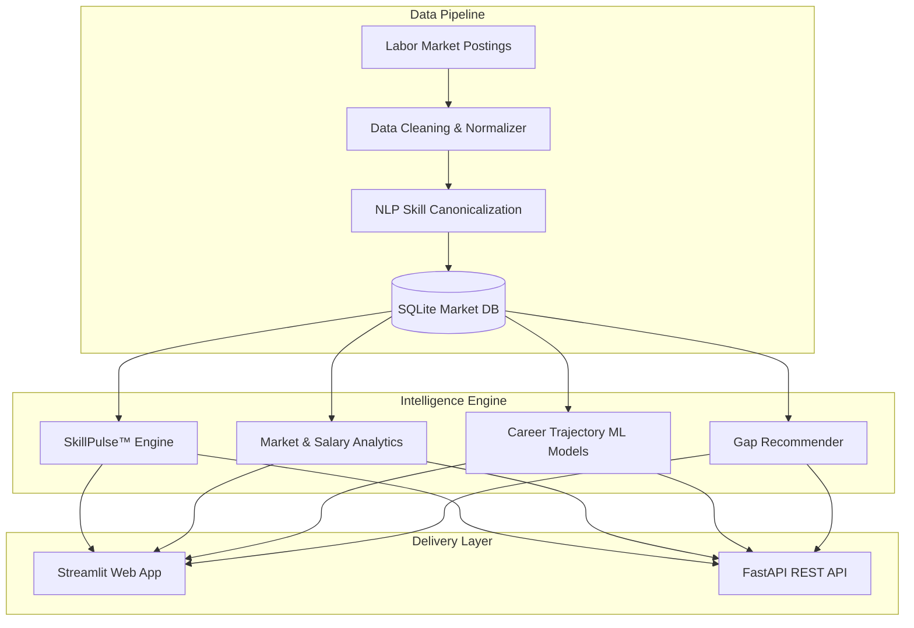

<div align="center">

# 🇮🇳 AROHA — AI Workforce & Skill Intelligence Platform
### *Data-Driven Talent Analytics, Compensation Benchmarks & Career Trajectory Engine*

> **"Don't just prepare for today's jobs — build for tomorrow's skills."**

[](https://github.com)
[](https://python.org)
[](https://streamlit.io)
[](https://fastapi.tiangolo.com)
[](https://scikit-learn.org)
[](#-automated-testing)
[](LICENSE)

[Product Overview](#-product-overview) • [Core Modules](#-core-platform-modules) • [Data & Provenance](#-data-intelligence--governance) • [Architecture](#-system-architecture) • [Quickstart](#-quickstart--installation) • [API Reference](#-api-integration)

</div>

---

## 🌟 Product Overview

**AROHA** is an enterprise-grade workforce intelligence and decision-support platform designed to solve a critical labor market challenge:
> **How can talent, educators, and enterprise leaders translate noisy job market data into quantifiable skill value, fair compensation benchmarks, and actionable upskilling pathways?**

Powered by continuous analysis of **17,400+ real-world tech job market records** and empirical career advancement data, AROHA eliminates speculation by delivering explainable mathematical valuations, compensation curves, and predictive machine-learning career trajectories.

### Who Uses AROHA?
- 👨‍💻 **Data & Tech Professionals:** Identify high-ROI skills, benchmark current compensation, and map custom learning journeys.
- 🏢 **Talent & People Ops Teams:** Access empirical salary benchmarks across experience tiers and monitor competitor skill demand.
- 🎓 **Universities & EdTech Institutions:** Align bootcamps and curricula with verified industry skill signals.

---

## ⚡ Core Platform Modules

```
                    ┌──────────────────────────────────────────────┐
                    │               AROHA PLATFORM                 │
                    └──────────────────────┬───────────────────────┘
                                           │
         ┌───────────────────┬─────────────┴───────┬───────────────────┐
         ▼                   ▼                     ▼                   ▼
  [SkillPulse™ Index]  [Market & Salary]    [Career Success ML]   [Skill Gap Radar]
  Transparent 0-100    Empirical curves     Predictive trajectory Dynamic matching
  Skill Valuation      & hiring benchmarks  & hike likelihood     & priority roadmap
```

### 1. 🎯 SkillPulse™ Valuation Engine (0 — 100)
A fully explainable, algorithmic score that quantifies the real-world market value of any technical skill:
$$\text{SkillPulse Score} = 0.35 \times \text{Demand} + 0.25 \times \text{Role Coverage} + 0.25 \times \text{Salary Signal} + 0.15 \times \text{Emerging Signal}$$

- **Market Demand (35%):** Normalized frequency across 15,800+ hiring postings.
- **Designation Coverage (25%):** Cross-role versatility across diverse titles.
- **Salary Premium (25%):** Observable compensation baseline uplift (relative to the ₹12.27 LPA market mean).
- **Frontier Signal (15%):** Growth index tracking emerging technologies (Generative AI, RAG, MLOps, Vector DBs).

### 2. 💰 Market & Compensation Intelligence
- **Continuous Salary Curves:** Real-world median compensation across 5 experience levels (Entry: ₹3.8L → Principal/Lead: ₹26.2L).
- **Enterprise Hiring Monitor:** Live employer profiles covering salary distributions, average experience requirements, and tech stack adoption (TCS, Accenture, IBM, Amazon, Infosys, and more).
- **Skill-Compensation Correlation:** Direct empirical analysis linking specialized technologies to market salary deltas (*strictly maintained with observational audit governance*).

### 3. 🧠 Predictive Career Advancement Models
- **Junior Data Scientist (JDS) Career Model:** Supervised classification model estimating high salary-hike probability based on competency proficiency:
  - **Logistic Regression:** 88.6% Accuracy | 0.889 F1-Score
  - **Random Forest:** 85.7% Accuracy | 0.872 F1-Score
  - **Feature Weighting:** Demonstrates empirical dominance of Mathematics & Statistics (+1.398 regression weight) and AI/ML over pure syntax knowledge.
- **Senior Data Scientist (SDS) Behavioral Model:** Analytical model identifying behavioral and trait correlations with high career attainment.

### 4. 🧭 Intelligent Skill Gap & Roadmap Recommender
- **Role Alignment Score (%):** Instant competency matching against target job profiles.
- **Interactive Competency Radar:** Multi-dimensional visualization comparing candidate skills against market expectations.
- **Prioritized Learning Milestones:** High-impact skill recommendations ranked by market demand, salary ROI, and learning prerequisites.

---

## 📊 Data Intelligence & Governance

AROHA processes comprehensive market benchmarks structured across four core empirical repositories:

| Data Repository | Volume | Key Dimensions | Pipeline & Processing |
| :--- | :---: | :--- | :--- |
| **Analytics Market Records** | **15,841** | `experience`, `description`, `key_skills`, `salary`, `location` | NLP tokenization, canonical skill alias normalization, continuous salary midpoint mapping. |
| **Specialized Data Science Postings** | **1,602** | `company`, `role`, `salary_bracket`, `hiring_volume` | Entity standardization, currency parsing, experience window imputation. |
| **Technical Advancement Benchmark** | **139** | `big_data`, `maths_stats`, `coding`, `ai_ml`, `salary_hike` | Verified 1.0–5.0 continuous scale normalization; stratified 75/25 train-test evaluation. |
| **Senior Leadership Trait Benchmark** | **161** | `neuroticism`, `extraversion`, `openness`, `conscientiousness` | Standardized psychometric features; binary classification validation. |

### Data Provenance & Trust Framework
AROHA embeds transparent provenance badges directly in the UI to ensure ethical, auditable AI:
- `[OBSERVED]` — Direct empirical facts aggregated from 17,400+ job listings.
- `[MODEL OUTPUT]` — Predictive inferences generated by trained ML models.
- `[ANALYTICAL SIGNAL]` — Derived composite scores (e.g., SkillPulse™).
- `[ILLUSTRATIVE]` — Forward-looking frontier indicators clearly separated from historical records.

---

## 🏗️ System Architecture



---

## 📁 Repository Structure

```text
AROHA/
├── app.py                     # Streamlit Web Application (Interactive Dashboard)
├── run.py                     # Unified Application Launcher
├── run_tests.py               # Comprehensive 24-test verification runner
├── requirements.txt           # Production Python dependencies
├── data/                      # Ingested datasets & SQLite benchmark DB
├── services/
│   ├── data_service.py        # Data loading, quality audits, cleaning
│   ├── skill_extraction.py    # NLP skill extraction & canonical mapping
│   ├── scoring.py             # SkillPulse™ multi-factor scoring engine
│   ├── market_intelligence.py # Salary, experience & company hiring analytics
│   ├── success_models.py      # Predictive ML models (Logistic Regression & Random Forest)
│   ├── recommender.py         # Multi-signal personalized recommendation engine
│   └── analytics.py           # Real-time dashboard metrics & market signals
├── backend/                   # FastAPI REST API services
├── frontend/                  # Web templates & analytics assets
└── tests/                     # 24 Automated unit & integration tests
```

---

## 🚀 Quickstart & Installation

### 1. Prerequisites
- Python 3.10+ (Tested on Python 3.12)
- Git

### 2. Setup
```bash
# Clone the repository
git clone https://github.com/<your-username>/AROHA.git
cd AROHA

# Create and activate virtual environment
python -m venv .venv
# On Windows:
.venv\Scripts\activate
# On Linux / macOS:
source .venv/bin/activate

# Install dependencies
pip install -r requirements.txt
```

### 3. Run the Web Application
```bash
streamlit run app.py
```
> The web application will launch in your browser at **`http://localhost:8501`**

### 4. Run the REST API Backend (Optional)
```bash
python run.py --fastapi
```
> Access interactive Swagger API documentation at **`http://localhost:8000/docs`**

---

## 🔌 API Integration

AROHA exposes high-throughput endpoints via FastAPI for seamless integration into existing HRMS, ATS, or EdTech portals:

| Method | Endpoint | Description |
| :---: | :--- | :--- |
| `GET` | `/api/health` | Service health status |
| `GET` | `/api/dashboard` | Macro KPI aggregates, top skills, salary trends |
| `GET` | `/api/skills/{name}` | SkillPulse™ breakdown & market benchmarks |
| `GET` | `/api/roles/{name}` | Role salary tiers, core & emerging skill requirements |
| `POST` | `/api/recommend` | Personalized gap analysis & recommended roadmap |
| `POST` | `/api/extract-skills` | NLP extraction and alias normalization from text/JDs |

---

## 🧪 Automated Testing

AROHA maintains strict code quality and data integrity via a 24-point test suite:

```bash
python run_tests.py
```

```text
=================================================================
             AROHA TEST SUITE — ALL SYSTEMS OPERATIONAL          
=================================================================
[PASS] Skill Extraction & Normalizer Engine (4/4 tests)
[PASS] Predictive Machine Learning Models (4/4 tests)
[PASS] SkillPulse™ Scoring & Market Intelligence (3/3 tests)
[PASS] Database & Analytical Aggregations (4/4 tests)
[PASS] Personalized Recommender Engine (2/2 tests)
[PASS] FastAPI Enterprise Endpoints (7/7 tests)
=================================================================
RESULTS: 24 Passed | 0 Failed | Execution Time: 1.94s
=================================================================
```

---

## 🗺️ Product Roadmap

- [x] SkillPulse™ 4-Factor Valuation Index
- [x] Experience-to-Salary Progression Analysis
- [x] ML-Driven Career Hike Estimator
- [x] Interactive Streamlit Dashboard & FastAPI Service
- [ ] Automated Resume / CV Ingestion & Skill Auto-Tagging
- [ ] Enterprise Multi-Tenant ATS Integration
- [ ] Longitudinal Real-Time Job Board Syncing

---

## 📄 License

This project is licensed under the [MIT License](LICENSE).
